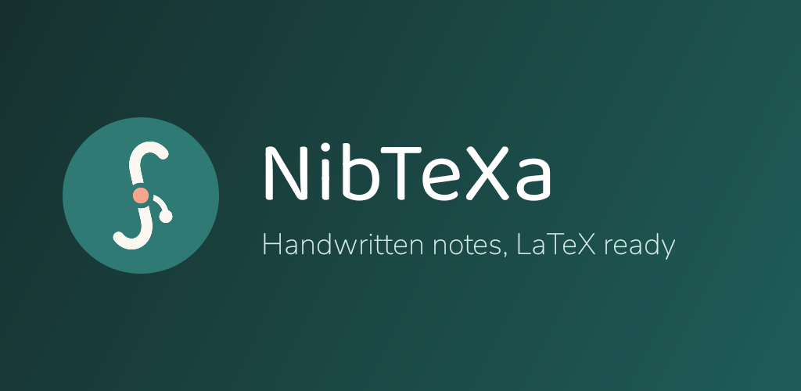
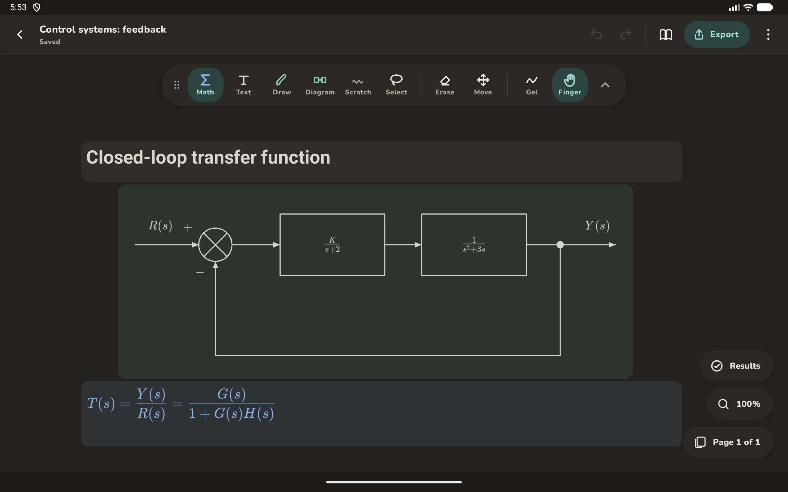
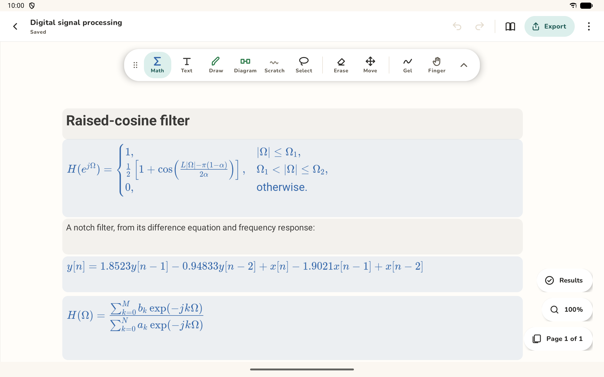
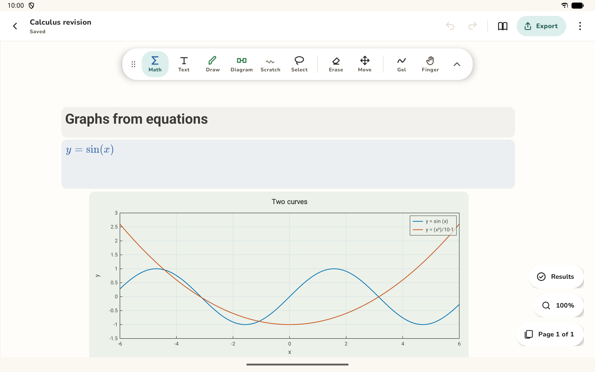
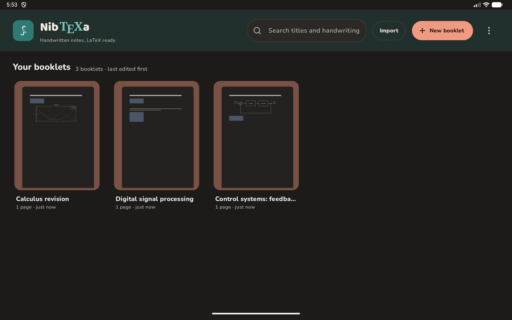
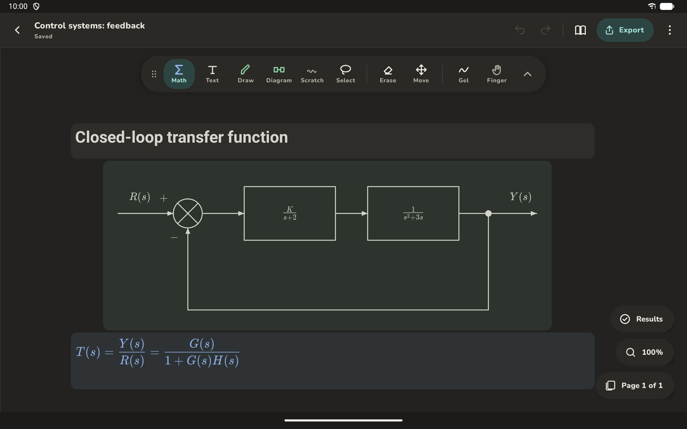

<p align="center">
  
</p>

<p align="center">
  <strong>Write by hand on your tablet. Get clean LaTeX. Push it to Git.</strong>
</p>

<p align="center">
  <a href="https://github.com/Iamthebarrow/nibtexa/actions/workflows/ci.yml"></a>
  <a href="LICENSE"></a>
  
  
  
</p>

<p align="center">
  <a href="#features">Features</a> ·
  <a href="#how-it-works">How it works</a> ·
  <a href="#get-started">Get started</a> ·
  <a href="docs/README.md">Documentation</a> ·
  <a href="CONTRIBUTING.md">Contributing</a>
</p>

<br>

NibTeXa is a notebook for Android tablets, made for maths, science and engineering notes. Your handwriting and equations become editable LaTeX on the tablet, your rough sketches become clean figures, and your notes export to a real document whenever you want one. No accounts and no ads.

<p align="center">
  
</p>

## Features

<table>
  <tr>
    <td width="50%" valign="top">
      <h3>Equations you can edit</h3>
      Handwritten maths becomes LaTeX on the tablet. Check each result, and correct it in a rendered editor rather than in raw source.
      <br><br>
      
    </td>
    <td width="50%" valign="top">
      <h3>Graphs from what you wrote</h3>
      Plot your equations on the page. The curve follows when you correct the equation, and exports sharp in PDF and LaTeX.
      <br><br>
      
    </td>
  </tr>
  <tr>
    <td width="50%" valign="top">
      <h3>Your whole library</h3>
      Booklets and folders, search across recognized handwriting, automatic backups, and a Trash for second thoughts.
      <br><br>
      
    </td>
    <td width="50%" valign="top">
      <h3>Dark mode too</h3>
      The whole app, including the page and your ink, follows your tablet's light or dark setting.
      <br><br>
      
    </td>
  </tr>
</table>

### Everything else

| | |
|---|---|
| **Pens made for the job** | Math, text, drawing, diagram and scratch pens, with ballpoint, gel and felt looks |
| **Clean diagrams** | Block diagrams, signal flow graphs and circuits: each stroke becomes an attached part |
| **Perfect shapes** | Hold the pen still at the end of a stroke to straighten it |
| **A real eraser** | Precise or whole-stroke, in four sizes, working as the pen moves |
| **Pen buttons** | Hold a button on your stylus for the eraser, lasso, page move or scratch pen |
| **Page control** | Blank, ruled or grid paper, several page sizes, margins and two columns |
| **Export** | PDF typeset on the tablet, LaTeX projects and Markdown |
| **Import** | LaTeX and Markdown, and PDFs to write on |
| **Git sync** | Commit and push to any Git server you set up; it never force-pushes |

The [feature guide](docs/guide/FEATURES.md) covers all of it, including the limits.

## How it works

1. **Write** with your stylus.
2. **Ink groups into regions** by itself when you pause.
3. **Maths and words are recognized** on the tablet.
4. **You check and correct** each result.
5. **Export** to PDF, LaTeX or Markdown, or push to your Git repository.

Your original ink is always kept, and a result that no longer matches its ink is marked out of date, never exported silently.

### What runs where

| | Runs on | Needs | Leaves the tablet |
|---|---|---|---|
| **Handwritten words** | Google ML Kit, on the tablet | A language download of about 20 MB | [Usage metrics](docs/PRIVACY.md) to Google, not your handwriting |
| **Handwritten maths** | [TexTeller](https://github.com/OleehyO/TexTeller), on the tablet | An optional [download of about 1.25 GB](docs/guide/MODEL_SETUP.md) from its authors, and about 1.7 GB of memory | Nothing |
| **Git sync** | JGit, on the tablet | A remote you set up | Only what you push, only where you choose |

Everything except these downloads, Git sync and ML Kit's metrics works offline. The math model works best with 6 GB of memory or more, and everything else runs without it.

## Get started

> [!NOTE]
> NibTeXa is early. Most testing is automated on an emulator, with basic use tried on one Samsung tablet with an S Pen. It runs on 64-bit ARM tablets with Android 8.0 or newer, and is made for a stylus.

**Install on your tablet:** follow [Installing NibTeXa](docs/guide/INSTALLING.md) to build a signed APK.

**Build from source:** you need the Android SDK with compile platform 37, and any JDK 17 or newer to launch Gradle. The build runs on JDK 21, which Gradle downloads if needed.

```sh
git clone https://github.com/Iamthebarrow/nibtexa.git
cd nibtexa
./gradlew assembleDebug   # build the debug APK
./gradlew installDebug    # install it on a running emulator or a connected tablet
```

On Windows, run `gradlew.bat` or use Git Bash. [Testing](docs/development/TESTING.md) has the test commands and emulator setup.

## Built with

<p>
  
  
  
  
  
  
  
</p>

Most of the logic is in pure Kotlin modules, tested on the JVM. See [Architecture](docs/development/ARCHITECTURE.md) and the [decision records](docs/decisions/README.md) for why each piece was chosen.

## Documentation

Read it all on the **[documentation website](https://iamthebarrow.github.io/nibtexa/)**.

| | |
|---|---|
| **Using the app** | [Features](docs/guide/FEATURES.md) · [Installing](docs/guide/INSTALLING.md) · [Model setup](docs/guide/MODEL_SETUP.md) · [Privacy](docs/PRIVACY.md) |
| **Working on the code** | [Architecture](docs/development/ARCHITECTURE.md) · [Testing](docs/development/TESTING.md) · [Releasing](docs/development/RELEASING.md) · [Third-party components](docs/THIRD_PARTY.md) |
| **How it was designed** | [Decision records](docs/decisions/README.md) · [Exports](docs/design/EXPORTS.md) · [Diagrams](docs/design/DIAGRAMS.md) · [Changelog](docs/CHANGELOG.md) |

Bug reports and ideas are welcome: see [CONTRIBUTING.md](CONTRIBUTING.md), and report security problems as described in [SECURITY.md](SECURITY.md).

## License

Copyright © 2026 Ian Barrow. NibTeXa is free software under the GNU General Public License, version 3, with an additional permission for Google ML Kit: see [LICENSE](LICENSE) and [NOTICE.md](NOTICE.md). It comes with no warranty. The components it includes keep their own licences, listed in [docs/THIRD_PARTY.md](docs/THIRD_PARTY.md).
