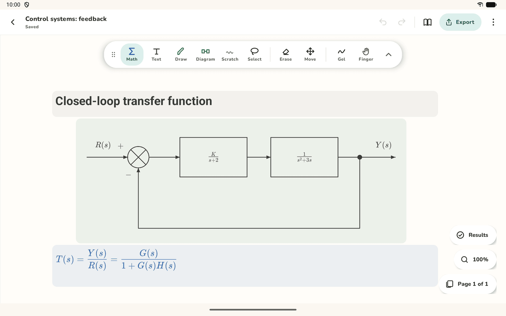
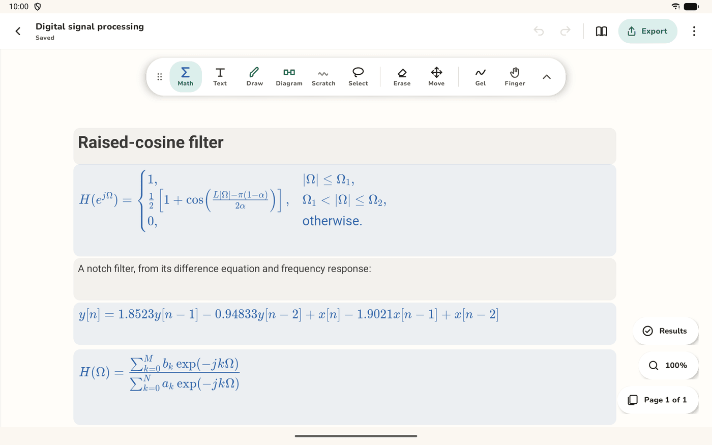
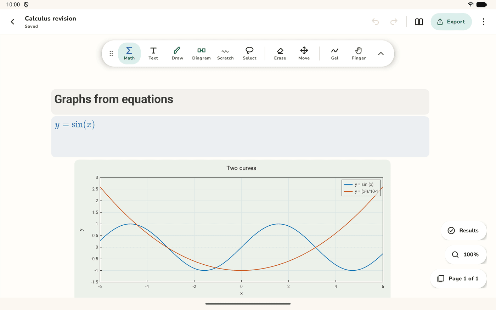
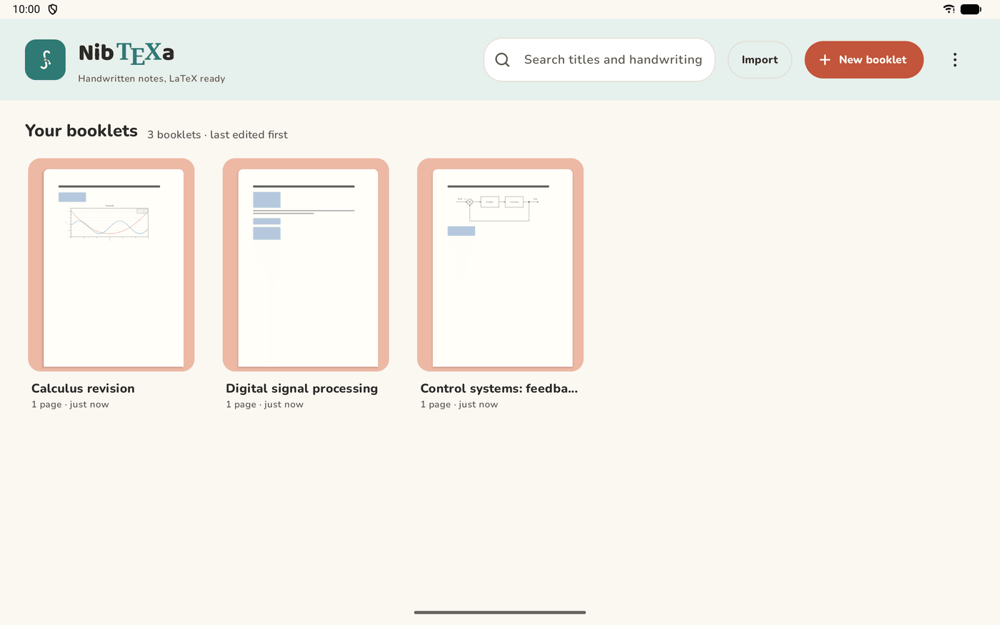
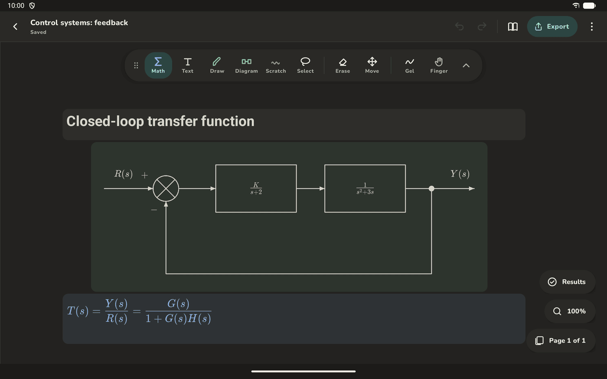

# Write by hand. Get clean LaTeX.

A notebook for Android tablets, made for maths, science and engineering notes. Your handwriting and equations become editable LaTeX on the tablet, and your notes export to a real document whenever you want one.

[Get started](guide/INSTALLING.md){ .md-button .md-button--primary }
[See the features](guide/FEATURES.md){ .md-button }
[View on GitHub](https://github.com/Iamthebarrow/nibtexa){ .md-button }

Free software. No accounts and no ads.

<section class="nib-features" markdown>

## Equations you can edit

Handwritten maths becomes LaTeX on the tablet, with no cloud service. Check each result, and correct it in a rendered editor rather than in raw source.

Your ink is always kept, and a result that no longer matches its ink is marked out of date, never exported silently.

[How recognition works](guide/MODEL_SETUP.md)

</section>

<section class="nib-features nib-features-flip" markdown>

## Sketches become clean figures

Draw with the Diagram pen, and each stroke becomes a box, a summing point or an attached line. Build block diagrams, signal flow graphs and circuits, then move parts around without breaking them.

Graph the equations you've written. A curve follows when you correct its equation, and exports sharp in PDF and LaTeX.

[How diagrams work](design/DIAGRAMS.md)

</section>

<section class="nib-features" markdown>

## Your notes stay yours

Everything lives on your tablet. Export PDF, LaTeX projects and Markdown, import LaTeX, Markdown and PDFs to write on, keep automatic backups in a folder you choose, and commit to any Git server you set up.

[What leaves the device, and when](PRIVACY.md)

</section>

<section class="nib-features nib-features-flip" markdown>

## Dark mode too

The whole app, including the page and your ink, follows your tablet's light or dark setting.

</section>

## And the details

- **Pens made for the job**

    Math, text, drawing, diagram and scratch pens, with ballpoint, gel and felt looks.

- **A real eraser**

    Precise or whole-stroke, in four sizes, working as the pen moves.

- **Pen buttons**

    Hold a button on your stylus for the eraser, lasso, page move or scratch pen.

- **Perfect shapes**

    Hold the pen still at the end of a stroke to straighten it.

- **Page control**

    Blank, ruled or grid paper, several page sizes, margins and two columns.

- **Git sync**

    Commit and push to any Git server you set up. It never force-pushes.

## How it was built

NibTeXa is written in Kotlin and Jetpack Compose, with most of its logic in pure Kotlin modules tested on the JVM. Maths recognition runs TexTeller through ONNX Runtime on the device, words use Google ML Kit, and equations are edited with MathLive in a locked-down WebView.

The reasoning is written down: read the [architecture](development/ARCHITECTURE.md) and the [decision records](decisions/README.md).

!!! note "An early version"
    Most testing is automated on an emulator, with basic use tried on one Samsung tablet with an S Pen. It runs on 64-bit ARM tablets with Android 8.0 or newer. Reading handwritten maths needs an optional download of about 1.25 GB and works best with 6 GB of memory or more. See the [known limits](guide/FEATURES.md#known-limits).

